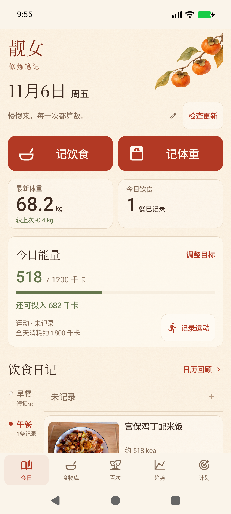
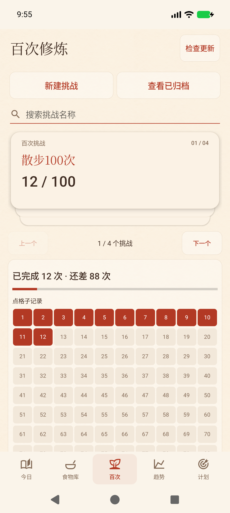

# 靓女修炼笔记 · Slim App


原生 Android 饮食、体重与运动记录工具。Android 9+，无需账号；饮食照片在设备上识别，营养数据库离线可用。

[下载最新 APK](https://github.com/ForXd/slim-app/releases/latest) · [提交问题](https://github.com/ForXd/slim-app/issues)

## 功能

- 拍照/相册识别食物，显示候选菜名，匹配离线营养数据；确认菜名与克重后再计入饮食。
- 8,886 条营养记录，其中 1,093 条中文菜谱参考；支持手动搜索与修改。
- 记录体重、运动，查看每日摄入、运动估算消耗及 7/30 天、自然月、年度趋势；点图查看具体数值，漏记不按零统计。
- 输入身高、体重、年龄、公式性别和日常活动估算维持热量，对比温和/标准/维持方案的初期理论参考；也可直接设置低于 1,500 kcal 的自定义目标。
- **100 次挑战**：名称搜索、三层纸卡堆叠、跟手倾斜切换与短拖回弹、自定义名称、10×10 网格、同一天多次打卡、时间与备注、撤销、重命名、归档和重新开启。
- 暖纸纹、宋体标题、黑体正文与清晰数字、朱红色的日记界面，四季水彩插画、体重/饮食摘要与餐食时间线；真实识餐照片随记录保存。
- 首页能量卡：低于目标绿色、达到目标朱红，超出时突出差值与运动记录入口。
- 日历回顾：记录日期标点，点选一天查看饮食、体重与运动，可回到今天。
- 四季水彩插画按设备月份自动切换，也能手选；首页激励语录可随时修改。
- 原生自适应笔记与新芽图标、180ms 页面转场、系统触觉反馈，保留各页滚动位置，尊重系统动画开关。
- **应用更新**：进入应用时每天自动检查一次 GitHub Release，首页及各页标题栏提供「检查更新」入口；下载进度、取消重试，核验大小、SHA-256、包名、版本及签名后由 Android 系统确认安装。

照片识别是候选提示，不会自动判断分量。菜谱营养、运动消耗及能量收支均为估算。现有照片回归中，宫保鸡丁、麻婆豆腐识别正确，红烧肉误识别为鳗鱼，需人工选择正确菜名。




截图使用隔离模拟器测试数据，正式安装不会自动添加示例记录。自动主题按3–5月春、6–8月夏、9–11月秋、12–2月冬切换，并非精确节气计算。计划中的体重变化为初期能量换算参考，不是减重承诺；计算依据见 [计划估算说明](docs/design/0.7/plan-estimates.md)。

## 数据与隐私

记录、识餐照片及挑战保存于应用私有存储。离线识别不上传照片。更新检查连接 GitHub，可在「检查更新」面板关闭。只有主动使用可选云端识别并填写 API 密钥时，照片才发送到所选服务。卸载会删除本地数据；同签名覆盖安装保留数据。旧 WebView 版记录支持一次性迁移。

## 构建

需要 JDK 17、Python 3、zip/unzip 和 Android SDK（platforms;android-35、build-tools;35.0.0）。无需 Node 或 Gradle。

```sh
export JAVA_HOME=/path/to/jdk17
export ANDROID_HOME=/path/to/android-sdk
export PATH="$JAVA_HOME/bin:$PATH"
SIGN_MODE=unsigned sh android/build.sh
```

输出 `artifacts/qingji-0.7.0-unsigned.apk`。也可设置 `BUILD_TOOLS` 和 `ANDROID_JAR` 覆盖 SDK 路径。

发布必须使用与用户已安装版本相同的私钥。已有版本延续原本本地 Android debug 签名，仅用于个人 APK 分发；仓库不保存私钥。请自行建立并妥善备份签名密钥，自己的分支无法直接覆盖官方安装版。

```sh
export SIGNING_KEYSTORE=/private/path/app.keystore
export SIGNING_ALIAS=your_alias
export SIGNING_PASSWORD='your-password'
sh scripts/release.sh
```

在 `android/AndroidManifest.xml` 增加 versionCode，versionName 使用 `x.y.z`。发布脚本构建签名 APK，生成 `update.json`、`SHA256SUMS`，不会自动上传。GitHub Release 标签为 `v<version>`，同时附加这三个文件，自动更新即读取 latest release 的清单。CI 仅构建未签名 APK，不能覆盖正式安装版。

## 验证

连接 Android 设备/模拟器，先安装签名应用，再运行：

```sh
export BUILD_TOOLS="$ANDROID_HOME/build-tools/35.0.0"
export ANDROID_JAR="$ANDROID_HOME/platforms/android-35/android.jar"
sh android/tests/build.sh
adb install -r /tmp/qingji-native-tests.apk
adb shell am instrument -w cn.qingji.diary.tests/cn.qingji.diary.FeatureCheck
adb shell am instrument -w cn.qingji.diary.tests/cn.qingji.diary.DeckCheck
adb shell am instrument -w cn.qingji.diary.tests/cn.qingji.diary.TrendCheck
adb shell am instrument -w cn.qingji.diary.tests/cn.qingji.diary.RevisionCheck
adb shell am instrument -w cn.qingji.diary.tests/cn.qingji.diary.EnergyCheck
adb shell am instrument -w cn.qingji.diary.tests/cn.qingji.diary.NativeCheck
```

测试 APK 默认使用本机 `~/.android/debug.keystore`，须与被测应用同签名。FeatureCheck 使用独立测试偏好文件，不修改用户挑战；DeckCheck 验证真实视图手势、嵌套滚动、动画竞态，不写入记录；NativeCheck 验证数据库与三张家常菜照片。

0.7.0 的动效参考与参数见 [motion.md](docs/design/0.7/motion.md)，验证记录见 [0.7](docs/validation/0.7/README.md)。

界面回归脚本为 `scripts/verify-ui.py`，仅在通过 `UiFixture -e seed yes` 初始化的隔离模拟器上运行。UiFixture 拒绝覆盖非空数据。

## 结构与来源

- `android/src/`：原生 Java Activity、图表、识别、挑战、更新模块。
- `android/data/`：离线数据库、别名、来源说明与菜谱许可。
- `android/model/`：Google AIY Food Classifier v1（Apache-2.0）。
- `android/deps/`：TensorFlow Lite 2.16.1（Apache-2.0）。
- `scripts/build-food-db.py`：数据库生成脚本；来源见 `android/data/sources.txt`。
- `tests/photos/`：HowToCook 的公共领域测试图片及固定来源。

挑战与更新交互参考 [青芽 Qingya](https://github.com/ForXd/tree-growh)（MIT）。本项目源代码采用 MIT；第三方模型、运行库、数据库和图片分别遵循其原始许可，见 [THIRD_PARTY_NOTICES.md](THIRD_PARTY_NOTICES.md)。
